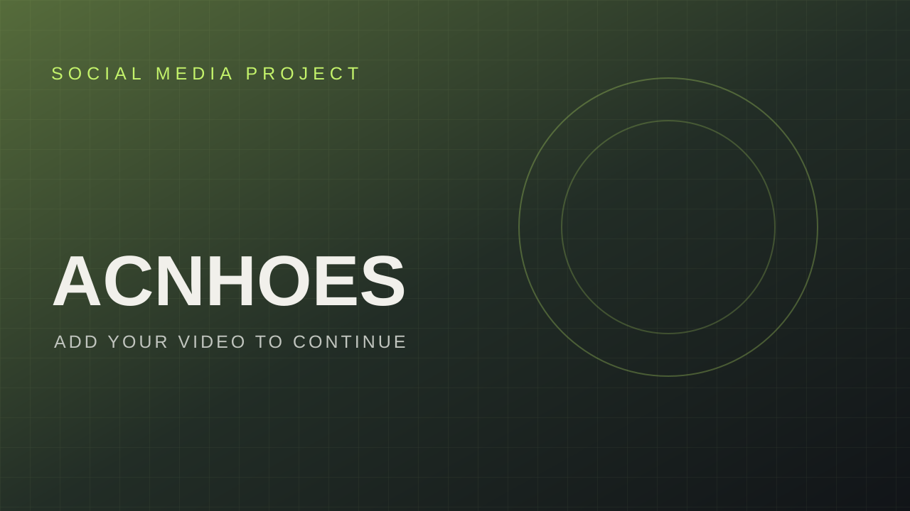

# Creative Portfolio

This repository contains my one-page creative portfolio, published with GitHub Pages.

## Site structure

```text
portfolio/
├── index.html
├── README.md
├── css/
│   └── main.css
├── js/
│   └── main.js
└── assets/
    ├── posters/
    │   ├── acnhoes.svg
    │   ├── acnhoes-irl.svg
    │   └── chibinvasion.svg
    └── videos/
```

## Before sharing the site

- Check the display name in `index.html`.
- Add a real public contact email when ready. The placeholder email has intentionally been removed so an `example.com` address is not shown publicly.
- Check the TikTok and Instagram links.
- Replace the three placeholder images with the actual video players as the clips are ready.

## Add the vertical videos

Export short MP4 clips using H.264 video and AAC audio. 720 × 1280 or 1080 × 1920 at 24–30 fps is a good starting point. Compress each clip for the web; do not upload camera originals or high-bitrate masters.

Put the video files in `assets/videos/` using these names:

- `acnhoes.mp4`
- `acnhoes-irl.mp4`
- `chibinvasion-wip.mp4`

Then, in `index.html`, replace the relevant placeholder block:

```html
<div class="project-media placeholder-media">
  
</div>
```

with a video player:

```html
<div class="project-media">
  <video controls playsinline preload="none" poster="assets/posters/acnhoes.svg" aria-label="Acnhoes short-form video">
    <source src="assets/videos/acnhoes.mp4" type="video/mp4">
    Your browser does not support HTML video.
  </video>
</div>
```

Repeat for the other two projects, changing the poster, filename, and accessible label. The CSS already supports vertical 9:16 videos on desktop and mobile. The project media area has no text overlay, so the video remains the focus.

## Preview locally

From the repository folder, run:

```bash
python -m http.server 8000
```

Open `http://localhost:8000` on the computer. To preview on a phone, start the server with:

```bash
python -m http.server 8000 --bind 0.0.0.0
```

Then open `http://YOUR-COMPUTER-IP:8000` on a phone connected to the same Wi-Fi network. Allow Python through Windows Firewall on private networks if prompted.

## Publish with GitHub Pages

This is a project site, so its URL is:

`https://takechisadao.github.io/portfolio/`

In the `takechisadao/portfolio` repository, open **Settings → Pages** and select **Deploy from a branch → main → /(root)**. Keep `index.html` in the repository root.

## GitHub Pages video limits

GitHub Pages is static hosting, not a dedicated video-streaming service. The published site has a 1 GB size limit and a soft bandwidth limit of 100 GB per month. Git LFS cannot be used to serve files through GitHub Pages. GitHub's browser upload limit and Git command-line limits also apply, so keep portfolio clips short and compressed.

## Project descriptions and credits

- **Acnhoes:** independent short-form comedy content featuring Animal Crossing characters. Animal Crossing and its characters belong to Nintendo; the project is not affiliated with or endorsed by Nintendo.
- **Acnhoes IRL:** ongoing 3D character integration experiment using Unity and Mocha Pro. The current description is intentionally limited to the work shown and does not claim reflections or occlusion work that is not in the current clip.
- **Chibinvasion:** original character project in development. The Butter test uses a temporary character from Trickcal; Butter is not an original Chibinvasion character. Butter and Trickcal belong to EPID Games; the project is not affiliated with or endorsed by EPID Games.
